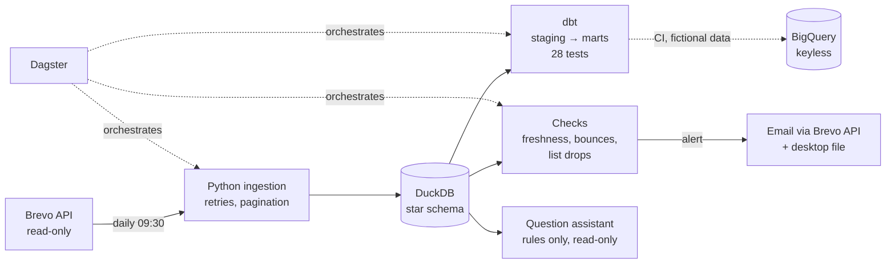

# Brevo Campaign Warehouse

[](https://github.com/thibaultbordrie-cloud/brevo-campaign-warehouse/actions/workflows/ci.yml)


An end-to-end data pipeline for email marketing: it loads campaign statistics and contact-list sizes from the [Brevo](https://www.brevo.com/) API into a [DuckDB](https://duckdb.org/) star schema every morning, transforms and tests them with dbt, orchestrates the whole chain with Dagster, copies it to BigQuery from CI without any stored key, raises alerts when something looks wrong, and answers questions in French with a read-only, rules-only assistant.

It is built to run unattended on a restricted Windows workstation: no admin rights (portable Python), HTTPS inspection, outgoing SMTP closed, no paid service. **This public version contains and uses fictional data only**: no customer data, no business figures, no key.

**[Live dbt documentation](https://thibaultbordrie-cloud.github.io/brevo-campaign-warehouse/)** · [Security](SECURITY.md) · [KPI dictionary](docs/KPI.md) · [Question assistant](docs/AGENT.md) · [Cloud copy](docs/CLOUD.md) · [dbt project](docs/DBT.md)

## Highlights

- **Star schema with daily history**: one row per campaign *per day*, so late clicks and list churn are visible over time. Loads are idempotent.
- **dbt** staging → intermediate → marts, 28 data tests, portable SQL that runs unchanged on DuckDB and BigQuery.
- **Dagster** assets with a *blocking* freshness check: stale data stops the run before dbt computes anything.
- **Alerts that reach a human**: deliverability, complaints, list drops, freshness; an email through the Brevo API *and* a file on the desktop, because an accepted email can still bounce.
- **Secrets never in plain text**: keys live in the Windows Credential Manager; CI signs in to Google Cloud with Workload Identity Federation; tests scan every tracked file for keys, identifying names and real e-mail addresses.
- **A question assistant that never guesses**: French question → SQL built by rules → five read-only locks → one-sentence answer, or an honest "je ne sais pas". Measured on 59 test questions, including paraphrases written *after* the rules.
- **CI on every push**: lint, 70+ pytest tests, dbt build on fictional data, the Dagster pipeline twice (healthy, then stale data that must stop), and the BigQuery copy.



## Try it in two minutes (fictional data)

```bash
git clone https://github.com/thibaultbordrie-cloud/brevo-campaign-warehouse.git
cd brevo-campaign-warehouse
python -m pip install -e ".[dev]"
python scripts/make_demo_db.py data/warehouse.duckdb      # 60 fictional campaigns, 5 lists, 3 days
python run.py kpis --limit 5
python run.py ask "Quel est le taux de clic moyen par périmètre ?"
python run.py ask "est-ce que les campagnes locales font plus de désinscrits que de clics"
python -m pytest -q
```

```text
Taux de clic moyen — par périmètre :
  - LOCAL · 0,91 %
  - NATIONAL · 0,7 %
```

## Engineering log: what broke, and what changed

Problems met while running the pipeline every day, each one now covered by a test or a guard:

| Symptom | Cause | Fix |
|---|---|---|
| HTTPS certificate errors | TLS inspection re-signs certificates | trust the Windows certificate store (`truststore`), never `verify=False`; a test forbids it |
| Alert emails never sent | outgoing SMTP closed by the network | send through the Brevo transactional API over HTTPS |
| Alert accepted by Brevo, never received | sender on a domain Brevo may not send for: bounced by DMARC | sender on the authenticated domain, and a second channel (desktop file) for every alert |
| List-drop alert could never fire | Brevo returns `totalSubscribers = 0` on every list | one `subscribers` rule (fallback to unique subscribers) used by alerts, dbt and the assistant |
| CI red overnight | DuckDB 2.0 removed a method used by 7 tests | tests rewritten to the stable API; both versions tested |
| Desktop alert file never written | a missing import on a path no test reached | test the real path; lint for undefined names in CI |
| Assistant answered a yes/no question with the wrong number | the comparison was not recognised, a total was returned instead | yes/no comparisons answered with both totals; other yes/no questions refused |

## Transformations with dbt

The `transform/` folder is a [dbt](https://www.getdbt.com/) project (adapter `dbt-duckdb`) built on top of the tables loaded by Python. It never modifies them: its models live in their own schemas.

```
sources (main)          staging (views)            intermediate (views)            marts (tables)
dim_campaign      ──►   stg_campaigns         ──►                            ──►  mart_campaign_kpis
fact_campaign_stats ─►  stg_campaign_snapshots ─►  int_campaign_latest_snapshot ─►  mart_scope_monthly
dim_list          ──►   stg_lists             ──►                            ──►  mart_list_growth
fact_list_size    ──►   stg_list_snapshots    ──►
```

- **28 data tests**: `unique`, `not_null`, `relationships`, `accepted_values`, a custom generic test `percentage_between_0_and_100`, a custom `unique_combination` test, and two singular tests (delivered never above sent; clickers never above openers, as a warning).
- **Documentation**: `dbt.bat docs generate --static` writes a single `transform/target/static_index.html` with the lineage graph and every column description.

```bat
dbt.bat build                    rem run every model and every test
dbt.bat docs generate --static   rem build the documentation site
```

## Continuous integration

On every push, GitHub Actions (`.github/workflows/ci.yml`) installs the project, lints it with ruff, runs the pytest suite, builds a warehouse filled with **fictional** data (`scripts/make_demo_db.py`), runs every dbt model and data test on it, and keeps the generated dbt documentation as a downloadable artifact. Real data never leaves the machine that runs the ingestion.

To try the project without a Brevo account:

```bat
python scripts/make_demo_db.py data/demo.duckdb
set WAREHOUSE_DB=..\data\demo.duckdb
dbt.bat build
```

## Question assistant

`run.bat ask "Combien de campagnes locales en mars 2026 ?"` → `Nombre de campagnes — périmètre local, mars 2026 : 4.` The assistant reads the French question with **rules only** (no AI model: nothing to pay, no key, it runs on the work computer), builds one SQL query, runs it **read-only** and says what it understood. A question it does not recognise gets "je ne sais pas" with examples, never a guess. Five independent locks keep it read-only (read-only connection, no file or network access, text check, row cap, timeout), each one attacked by a test.

Scores on fictional data: 30/30 on the main questions, **18/20 on paraphrases written after the rules at the first run** (now 23/23 with the misses found by a user), 6/6 out-of-scope questions refused. First test by a user with free wording: 6/8, the 2 misses fixed and turned into tests. The scores are CI tests. Details and limits: [docs/AGENT.md](docs/AGENT.md).

## Cloud copy on BigQuery

The same dbt project also runs on **Google BigQuery**: the models are written in portable SQL, and the source dataset switches on the target. On every push to `main`, a second CI job loads the **fictional** demo warehouse into a BigQuery sandbox and runs `dbt build --target bigquery` there.

- **No key stored anywhere**: GitHub Actions signs in with Workload Identity Federation, accepted by Google only for this repository.
- **No real data in the cloud**: the loader builds its own demo warehouse and cannot read the real one (checked by a test).
- **No bill possible**: the sandbox has no billing account; dbt queries are also capped at 1 GB read each (`maximum_bytes_billed`).

Details, costs and the one-time setup: [docs/CLOUD.md](docs/CLOUD.md).

## Orchestration with Dagster

`orchestration/definitions.py` describes the whole pipeline as Dagster assets: the four ingestion tables, then one asset per dbt model (dbt tests become asset checks), a **blocking freshness check** (today's photo must be loaded, otherwise dbt does not run), a daily schedule at 09:30 Paris time, and a failure sensor that sends the same alert as the Windows task (email + desktop file).

`WAREHOUSE_SOURCE=demo` (default) uses fictional data; `WAREHOUSE_SOURCE=brevo` reads the real API. CI runs the pipeline twice on every push: once healthy, once with stale data, which must stop before dbt.

On a personal computer (where compiled packages cannot be installed, the daily run stays a Windows scheduled task):

```bash
python -m venv .venv && source .venv/bin/activate
pip install -e . -r orchestration/requirements.txt
python transform/run_dbt.py parse --project-dir transform --profiles-dir transform
dagster dev -f orchestration/definitions.py      # then open http://localhost:3000
```

## Daily run

`ingest_daily.bat` runs the ingestion without any prompt and appends every run to `logs/ingest.log`:

```
[21/10/2026 09:30:02,10] start
Loaded 60 campaigns into ...\data\warehouse.duckdb
Loaded 5 contact lists into ...\data\warehouse.duckdb
[21/10/2026 09:30:31,42] end, exit code 0
```

It is scheduled with the Windows Task Scheduler (no admin rights needed):

```bat
schtasks /Create /TN "BrevoWarehouse_Ingest" /TR "\"%CD%\ingest_daily.bat\"" /SC DAILY /ST 09:30 /F
```

## Alerts

After each morning load, `run.py alerts` runs data checks on the latest snapshots and sends **one** summary email to the owner only if something needs attention:

| Check | Threshold |
| --- | --- |
| Today's snapshot is missing (the load did not run) | — |
| Bounce rate of a campaign sent in the last 3 days | above 2 % of sent, or 1 % hard bounces |
| Spam complaints | above 0.1 % of delivered |
| A contact list lost subscribers since yesterday | above 1 % |
| More unsubscribes than clickers (information) | — |

The email goes through Brevo's transactional API over HTTPS (`ALERT_METHOD=api`, default), because outgoing SMTP is often closed on company networks; `ALERT_METHOD=smtp` uses the SMTP relay instead. If the load itself fails, `ingest_daily.bat` sends a failure email instead, and an email problem never breaks the daily run.

A second, independent channel writes `ALERTE brevo-warehouse.txt` on the Windows desktop for **every** alert, with the email status. It is not only a fallback for a failed send: during a failure drill, Brevo accepted the email and the receiving server bounced it afterwards (the sender was on a domain Brevo may not send for). Since then the sender (`ALERT_FROM`) must be an address on the domain authenticated in Brevo. Setting `WAREHOUSE_SIMULER_PANNE=1` makes the next load fail on purpose, to test the whole alert chain. Thresholds live as constants at the top of `alerts.py`; `run.py alerts --dry-run` prints the email without sending it.

## Quick start (Windows)

```bat
copy .env.example .env
rem edit .env (no key in it), then store the key encrypted in the Windows Credential Manager:
python run.py secret set BREVO_API_KEY
python run.py secret check
python -m pip install -e .[dev]
python -m pytest
python -m brevo_warehouse ingest
python -m brevo_warehouse kpis --limit 20
python -m brevo_warehouse query sql\analyses\04_local_corrige.sql
python -m brevo_warehouse report
```

`report` runs every query of `sql/analyses` and saves all results in one text file, `reports/analyses_<date>.txt` (kept out of Git).

Portable Python (no install rights)? Use `run.bat`, or `python run.py <command>`: portable builds ignore `PYTHONPATH`, so `run.py` adds `src` to the path itself.

## Secrets

No key is stored in plain text. API keys live in the Windows Credential Manager (encrypted with the user's session, via `ctypes`, nothing to install); `config.py` reads them when the environment does not set them, which also keeps CI (environment variables) working. `secret check` fails while a key is still in `.env`. A test scans every file Git would publish for Brevo key patterns.

## Networks with TLS inspection

If you get `CERTIFICATE_VERIFY_FAILED ... self-signed certificate in certificate chain`, the network re-signs HTTPS traffic with its own certificate authority. Install [truststore](https://pypi.org/project/truststore/) (`python -m pip install truststore`): the client then uses the operating system's certificate store, which already trusts that authority. For `git push`, the same problem is solved with `git config --global http.sslBackend schannel`.

## KPI definitions

| KPI | Formula |
| --- | --- |
| Open rate | unique views ÷ delivered |
| Click rate | clickers ÷ delivered |
| CTOR | clickers ÷ unique views |
| Unsubscribe rate | unsubscriptions ÷ delivered |
| Scope | `LOCAL` if the name starts with `LOCAL`, contains `_STORE_` or `fermeture` (store closure); otherwise `NATIONAL` |


## Analyses

| File | Question |
| --- | --- |
| `01_kpis_par_tag.sql` | Average KPIs per group of campaigns |
| `02_plus_de_desinscrits_que_de_clics.sql` | Which campaigns lost more subscribers than they got clickers? |
| `03_jour_de_la_semaine.sql` | Does the weekday of sending matter? |
| `04_local_corrige.sql` | Local vs national, with the corrected classification |
| `05_evolution_listes.sql` | How did each contact list change since the previous day? |
| `06_clics_jour_apres_jour.sql` | How many new clickers arrive each day after a send? |
| `07_top_ctor.sql` | Which campaigns convinced the most openers to click? |
| `08_tendance_mensuelle.sql` | How do volume and KPIs evolve month by month? |
| `09_ouvertures_apple.sql` | How much of the open rate is automatic Apple opens? |
| `10_delivrabilite.sql` | Which campaigns bounced the most, with how many spam complaints? |
| `11_heure_envoi.sql` | Does the hour of sending matter? |
| `12_longueur_objet.sql` | Does subject line length affect the open rate? |
| `13_objet_promo.sql` | Do subjects announcing a discount perform differently? |
| `14_local_par_mois.sql` | Is the local vs national gap stable over time? |
| `15_taille_audience.sql` | Are small targeted sends more engaging than large ones? |

## Project layout

```
src/brevo_warehouse/
  config.py       settings from environment / .env (no secret in code)
  vault.py        keys in the Windows Credential Manager
  agent/          question assistant: French rules -> SQL, guard, evaluation
  client.py       Brevo API client: retries, pagination, corporate certificates
  ingest.py       load into raw / dim / fact tables
  schema.sql      star schema and KPI views
  report.py       run all analyses into one text report
  alerts.py       daily data checks and owner email
  __main__.py     command line
orchestration/
  definitions.py  Dagster assets, freshness check, schedule, failure alert
sql/analyses/     analysis queries
evals/            test questions for the assistant (main, paraphrases, out of scope)
tests/            pytest suite (70 tests) with fictional fixtures
ingest_daily.bat  unattended daily run, logged
dbt.bat           runs dbt from the transform folder
scripts/          demo warehouse generator (fictional data), BigQuery loader, GCP setup
.github/workflows CI: tests, dbt build and docs, Dagster pipeline, BigQuery copy
transform/        dbt project: staging, intermediate and marts models, tests, macros
docs/             learning notes and KPI dictionary (French)
```

## Roadmap

- [x] Campaigns and global statistics
- [x] Unattended daily ingestion with logs
- [x] Contact list sizes over time
- [ ] SMS campaigns
- [x] dbt models on top of the loaded tables, with tests and documentation (programme block 3)
- [x] Continuous integration: tests and dbt build on every push
- [x] Data checks and alert email after each daily load (block 4)
- [x] Orchestration with Dagster, blocking freshness check, failure drill (block 4)
- [x] Cloud copy on BigQuery, keyless CI, cost guard (block 5)
- [x] Question assistant in French, rules only, read-only, measured on 59 test questions (block 6)

## License

MIT. Built by Thibault Bordrie as part of a self-directed data engineering programme (2026–2027).
